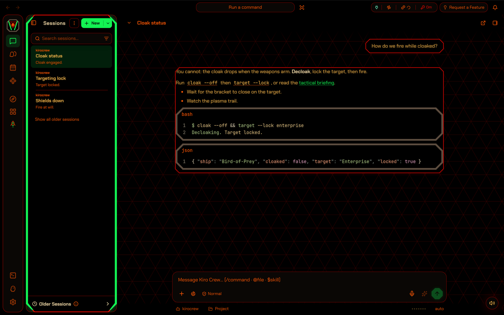
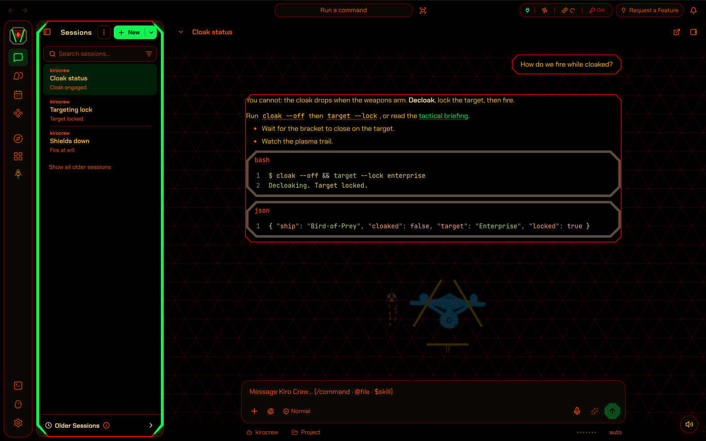
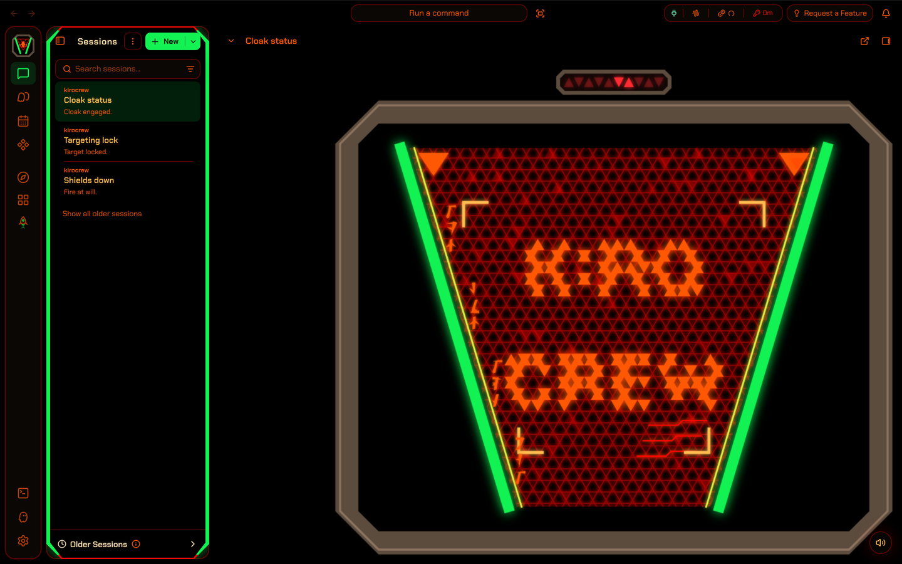
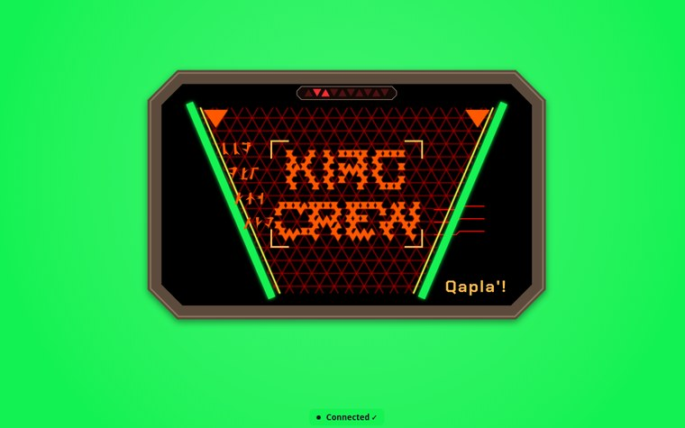
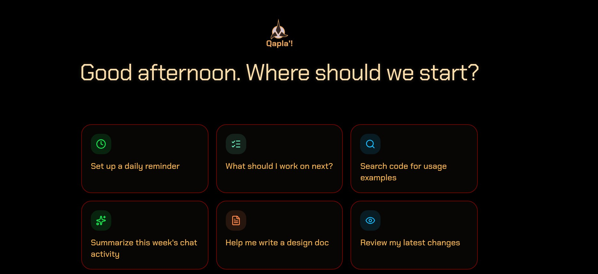
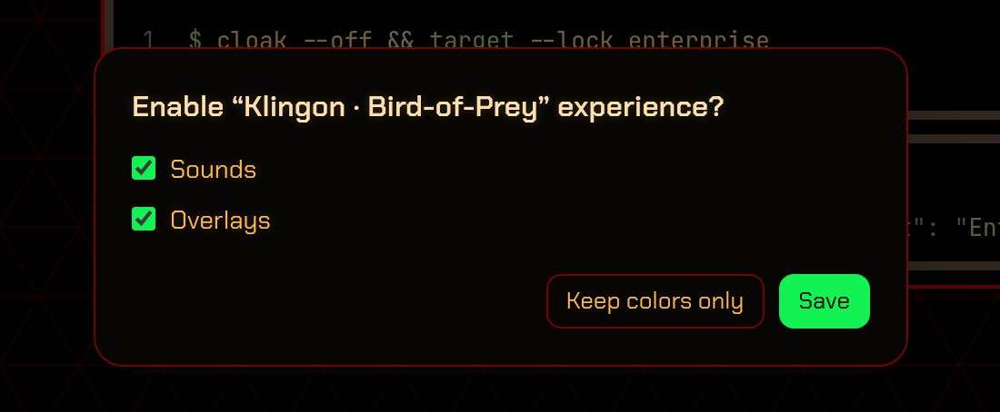

# Kiro Crew theme: Klingon · Bird-of-Prey

An unofficial Kiro Crew theme modeled on the Klingon Bird-of-Prey bridge in *Star Trek III* to *VI* (1984 to 1991): Kruge's ship, the captured *Bounty*, Klaa's ship and Chang's.

- **Look:** Klaa's targeting display in *The Final Frontier*. A faint red triangle lattice behind the chat, a session list framed by glowing green sides, amber panel light for the text, orange target triangles for secondary text, code in the bronze octagonal housing of the bridge viewscreen.
- **Thinking indicator:** an orange target of lit triangles with an amber bracket closing on it.
- **Welcome mark:** the Klingon Empire emblem as the films show it, black prongs edged in gold on a pale disc ringed in gold, traced from the Klingon transmission at the start of *The Undiscovered Country*, with the Klingon phrase *Qapla'!* ("Success!") under it.
- **Screensaver:** after 15 minutes with no key press, click, scroll or touch, the targeting display fills the screen: green sides, the red lattice, orange glyph columns and corner triangles, the app's name drawn out of lit triangles with a bracket locking onto it, the red triangle indicator that sits above Chang's viewscreen, and *Qapla'!* in the lower right corner. Press a key or click to dismiss it; the click does not reach the app. The dashboard's nav, session list and chat header stay on top, so the display fills the area to their right. It does not run when the OS is set to reduce motion, and it stops after 30 minutes.
- **Tracking display:** behind the chat, the Bird-of-Prey's screen tracks the Federation ships its captains hunted: the Enterprise as Kruge's monitor drew it in *The Search for Spock*, the *Grissom* and the *Excelsior*, outlines traced from frames of *III* and *VI*, in the cyan of Kruge's monitor. One ship at a time crosses slowly; Chang's triangle reticle from *The Undiscovered Country* closes on it, orange, and lights yellow as it locks, with the Klingon emblem and two columns of orange glyphs beside it. Then the screen stays empty for half a minute or more. It is dim enough that body and muted text keep their contrast, takes no clicks, draws 20 frames a second while a ship is in view and nothing between ships, and pauses while the tab is hidden. When the OS asks for reduced motion, the chat shows one still frame of it instead.
- **Desktop splash:** while the desktop app waits for its gateway, the same targeting display in the bronze housing, with *Qapla'!* in the lower right corner. It holds still when the OS asks for reduced motion.
- **Code:** code blocks, diffs and the file viewer use the `everforest-dark` scheme (green, orange, red and amber) in both modes.
- **Light mode:** the same as dark. The films have no light screens.
- **Type:** Chakra Petch, a free sans whose letters have cut corners, like the screen housings. The Klingon screens carry no Latin type, only Klingon glyphs, so there is no film face to match.
- **Shapes:** cut (bevelled) corners use CSS `corner-shape: bevel`, which Chrome, Edge and the desktop app draw. A browser without it shows rounded corners instead.
- **Glyphs:** the Klingon-style glyphs on the splash and the screensaver are original, made in code. They are decoration: they spell nothing, as the film graphics did not.
- **Sounds:** harsh, buzzy console tones when the theme turns on or off, when a reply arrives, on notifications, and when an approval waits, and a rising shimmer when the theme turns on (a nod to the decloak). Original sounds made in code. None is taken from the films. They stay silent under reduced motion and while sounds are muted.

The first time you pick this theme, Kiro Crew asks which parts to turn on: Sounds, and Overlays (the tracking display and the screensaver). Change either later under Settings → Display → Theme → Experience.

Needs Kiro Crew 0.13.0 or newer; older versions refuse the pack.

Pick System under Settings → Display → Font Family to keep the OS font.

| Chat | Tracking display | Screensaver | Desktop splash | Welcome mark | First pick |
|---|---|---|---|---|---|
|  |  |  |  |  |  |

## The two Klingon packs

| Repo | Films |
|---|---|
| [kirocrew-theme-klingon-k-tinga](https://github.com/leozhad/kirocrew-theme-klingon-k-tinga) | *Star Trek: The Motion Picture* (1979) |
| This one | *Star Trek III to VI* (1984 to 1991) |

## Install

1. Open Settings → Display → Theme.
2. Under **Install Theme**, choose **GitHub** and paste `https://github.com/leozhad/kirocrew-theme-klingon-bird-of-prey`.
3. Install, then pick **Klingon · Bird-of-Prey** in the Theme list.

To update, install the same URL again.

From a browser that is not on the gateway's machine (a phone, say), use a zip instead: on GitHub choose **Code → Download ZIP**, then in Install Theme set **Theme source** to **Zip file** and pick that file. Kiro Crew finds the pack inside the zip's one top-level folder.

## Use your own sounds

The sounds are WAV files in `audio/`, named in `audio/manifest.json`: `activate` and `deactivate` (the theme turns on or off), `received` (a reply arrives), `notify` (notifications) and `approval` (an approval waits). To play your own, clone or unzip this repo, replace any of those files with a sound of your own under the same name, and install that folder (**Local folder**) or a zip of it. Kiro Crew accepts WAV, MP3 or OGG; if you change the extension, change `src` in `audio/manifest.json` to match. Keep each file under 512 KB. Kiro Crew stops a sound after its `maxDuration` (at most 5 s for `activate`, 1 s for `received`, 2 s for the others). Do not edit the installed copy: reinstalling replaces it.

## Film evidence

Colours were measured on [TrekCore](https://movies.trekcore.com/gallery/) Blu-ray screencaps: the film's hue and saturation, with brightness set for contrast (body text at least 7:1, secondary text and status colours at least 4.5:1). The frames are not in this repo.

Sources: *The Search for Spock* and *The Voyage Home* 4K remaster Blu-ray (2021); *The Final Frontier* and *The Undiscovered Country* 4K remaster Blu-ray (2022). Bridge set as built for *The Voyage Home*: Jack T. Collis (design); backlit graphics: Michael Okuda; moving video displays: Video Images; in *The Final Frontier* it also carried production designer Herman Zimmerman's work ([Memory Alpha, Klingon Bird-of-Prey (2280s)](https://memory-alpha.fandom.com/wiki/Klingon_Bird-of-Prey_(2280s))).

| Colour | Film, frame | What it is | Film hue, sat |
|---|---|---|---|
| lattice | V 542 | the red triangle lattice of Klaa's targeting display | 2°, 1.00 |
| edge | V 542 | its glowing green sides | 137°, 0.92 |
| target | V 542 | the orange target and corner triangles | 20°, 0.98 |
| amber | V 681 | the amber backlit panel on Klaa's bridge | 37°, 0.69 |
| monitor | III 775 | the cyan Enterprise wireframe on Kruge's monitor | 197°, 0.92 |
| script | III 775 | the pink glyphs under it (saturation floor 40/255) | 324°, 0.31 |
| console | VI 1734 | the green-lit console blocks on Chang's bridge | 157°, 0.56 |
| panel | IV 409 | the red backlit console panels on the *Bounty* | 1°, 0.89 |
| bars | IV 409 | the orange bars on the same panels | 21°, 0.72 |
| indicator | VI 1749 | the red triangle indicator over Chang's viewscreen (value floor 60/255) | 358°, 0.83 |
| housing | III 775 | the bronze housing round Kruge's monitor (saturation floor 5/255) | 28°, 0.32 |

Shapes: the targeting display is a trapezoid, wide at the top, with the green bars along its slanted sides and a thin yellow-green line inside each (V 542). Orange triangles sit in its upper corners and orange glyphs run down the left side in short columns (542). The target is drawn out of lit lattice triangles, and a bracket closes on it (542, 543). Red stepped rails sit at the right (542). The viewscreen and monitor housings are bronze octagons, a rectangle with cut corners (III 775, VI 1749); a strip of red triangles, alternately up and down, sits above Chang's screen (VI 1749).

Type: none on the Klingon screens. The orange "60" countdown digits in III (frames 848, 869, 872) are the Enterprise's self-destruct, seen on a Klingon monitor, so they are not used. Chakra Petch, as above.

Emblem: see "The emblem" below. The amber backlit panel on Klaa's bridge (V 681) carries a red-orange mark, but it is out of focus and its two side arms both rise, so it is not a clear emblem; only its amber is used (as `amber`).

### The tracking display

Each pack's `overlays/ambient.html` is an animated background in the spirit of the Matrix packs' digital rain, drawn behind the chat: Federation ships crossing the screen as if tracked by the Klingon ship, era-true per pack, with outlines traced from the films (asked for on Nov 20, 2026).

#### What the films' Klingon screens show

The films do put Federation ships on Klingon targeting screens:

| Film, frame | Screen | What it shows |
|---|---|---|
| III, Chapter 7, 775 | Kruge's Bird-of-Prey monitor | the Enterprise as a cyan line-art front view over a lattice, pink glyphs under it |
| VI, Chapter 12, 1830, 1834, 1835 | Chang's targeting display | a red triangle lattice in an elongated hexagon, glyph columns on both sides, the Enterprise-A as an orange icon. A triangle of two slanted bars closes round it: orange in 1834, lit yellow in 1835, with a bar and two ticks under it |
| V, Chapter 5, 542, 543 | Klaa's targeting display | its target, the probe *Pioneer 10* ([Memory Alpha, Pioneer 10](https://memory-alpha.fandom.com/wiki/Pioneer_10)), and an amber bracket that closes on it (the screensaver uses these) |
| TMP, Chapter 1, 58, 92, 94 | the K't'inga's tactical display | a cyan-white contact (V'Ger); a red hexagon pointed at both ends that frames the Klingon ship's own orange symbol (94; absent in 92); three red dots on the grid in 58, which look to be the torpedoes in flight after the firing in 52 to 57 |

In *The Motion Picture* the K't'inga's screen tracks V'Ger, not a Federation ship: none of TrekCore's 113 frames of Chapter 1, the only chapter with Klingon screens, shows a Federation ship on one. Nothing on it closes on or locks a contact either: the hexagon frames the Klingon ship itself, and the contact sits outside it (94). So the K't'inga pack's lock is ours: the film's own Federation ships, in the screen's contact colour, inside a box in the shape of that hexagon, which closes and locks; and three red lights, in the dots' colour, that step under it.

The lit reticle's colour is measured on VI 1835 (the triangle's box, lit pixels, the method above): hue 48° to 49°, saturation 0.91 to 0.97. The build keeps it as `BP.lock` (49°, 0.97), and the source repo's frame check re-measures it.

#### Which ships, and why

| Pack | Ship | Why it fits | Traced from |
|---|---|---|---|
| K't'inga | the refit Enterprise (NCC-1701) | the film's starship, sent to intercept V'Ger after it destroys the K't'inga cruisers | TMP, Chapter 14, frame 626: on its way to V'Ger, three-quarter view from above |
| K't'inga | the long-range shuttle *Surak* | the Federation courier that brings Spock from Vulcan to the Enterprise ([Memory Alpha, Long range shuttle](https://memory-alpha.fandom.com/wiki/Long_range_shuttle)) | TMP, Chapter 13, frame 572: side view, bow right |
| Bird-of-Prey | the Enterprise, as Kruge's monitor drew it | Kruge's Bird-of-Prey attacks it in III ([Memory Alpha, USS Enterprise (NCC-1701)](https://memory-alpha.fandom.com/wiki/USS_Enterprise_(NCC-1701))); Klaa's pursues the Enterprise-A in V, Chang's attacks it in VI ([Memory Alpha, USS Enterprise (NCC-1701-A)](https://memory-alpha.fandom.com/wiki/USS_Enterprise_(NCC-1701-A))). The refit and the -A are the same design | III, Chapter 7, frame 775: the monitor's own line art |
| Bird-of-Prey | USS *Grissom* (NCC-638) | destroyed by Kruge's Bird-of-Prey over the Genesis planet ([Memory Alpha, USS Grissom (NCC-638)](https://memory-alpha.fandom.com/wiki/USS_Grissom_(NCC-638))) | III, Chapter 2, frame 233: over Genesis, end-on view |
| Bird-of-Prey | USS *Excelsior* (NCC-2000) | with the Enterprise-A, battles Chang's Bird-of-Prey at Khitomer ([Memory Alpha, USS Excelsior (NCC-2000)](https://memory-alpha.fandom.com/wiki/USS_Excelsior_(NCC-2000))) | VI, Chapter 1, frame 47: three-quarter front view, bow left |

Checked and not used: Epsilon IX (a station that tracks the Klingons, and does not cross a screen); the travel pod and work bees in TMP (too small to read as ships); the *Saratoga* in IV (no Klingon scene); TMP 611, 612 and 631 (the Enterprise head-on, which does not read as crossing); TMP 430 (Chapter 10, a three-quarter view from below: traced first, but at 155 to 230 px the edge-on saucer and the nacelles read weakly as the Enterprise; 626 shows the saucer from above). Chapters 4, 10, 11, 13, 14, 15, 25 and 27 were looked through for these; the *Excelsior*'s side view in VI 1764 (smeared by its jump to warp); the top-view schematics in III 181 and VI 1823 (Federation screens, not Klingon ones); Chang's orange Enterprise icon in VI 1834 (the reticle overlaps it, so it cannot be traced cleanly; Kruge's line art is the clean Klingon-screen Enterprise).

#### How the ships are traced

The same way as the K't'inga symbol and the emblem: vector data made by the source repo's tracer (OpenCV); the frames are not stored.

- **Space shots** (626, 572, 47): the lit hull against black space, thresholded on HSV value (15, 22 and 40 out of 255) inside a box round the ship, closed (a 13 px kernel for the *Surak*, so its painted dark bands do not cut notches; 9 and 5 px for the others), the largest part kept, smoothed with a Gaussian blur; the outer contour and the large holes (the open space between hull, pylons and nacelles) taken with OpenCV and simplified to 1.4 px. Smaller holes are filled.
- **The *Grissom*** (233) sits against a planet, so its pixels are a GrabCut segmentation of its box, gated on value 40 (the planet's night side is 25 to 49 next to the ship; at 60 the dark underside of the saucer dropped out and the saucer looked cut off from its pylons). Holes under 8,000 px² are filled.
- **Kruge's monitor** (775): every contour of the cyan pixels (hue 197° ± 16°, saturation and value floors 80 and 110), filled even-odd so the gaps between the lines stay open: the monitor's own line art. Stray specks outside the drawing (outer contours under 25 px²) are dropped.

The source repo's frame check fills each outline on its frame and compares it with the frame's lit ship pixels, using the tracer's own threshold, so it checks that the data is still the trace of that frame, not that the segmentation is right (that was checked by eye, outline over frame). IoU at trace time: 0.97 (Enterprise, 626), 0.92 (*Surak*), 0.91 (Kruge's Enterprise), 0.89 (*Grissom*, whose outline comes from GrabCut, not from that threshold) and 0.93 (*Excelsior*). Each floor is that value minus 0.02, and the number of shapes must not change.

#### How it moves, and how bright it is

- **One ship at a time.** The first crosses 6 s after the page loads; each crossing takes 52 to 68 s, mostly across the lower part of the page; then the screen stays empty for 32 to 52 s. The order is shuffled from a fixed seed, so every ship of the pack comes round before one repeats.
- **The lock.** When the ship is well inside the open area, the reticle appears at 2.3 to 2.4 times its size and closes on the ship in 2.6 s. The K't'inga's box then blinks three times (0.3 s on, 0.2 s off) and holds, and its three red lights step every 0.9 s; the Bird-of-Prey's triangle flashes twice (0.25 s lit, 0.15 s orange) and stays lit. That is at most 2.5 flashes in a second, in thin lines, with a luminance change under 0.05: under WCAG 2.3.1's three flashes a second. The readout fades in on the side the ship came from, stays there, and one glyph changes every 0.8 s. The lock lets go before the ship leaves.
- **Cost.** A 20 fps timer while a ship is in view, drawing only the part of the screen it covers; no drawing between ships; paused while the tab is hidden.
- **Brightness.** Each colour keeps its film hue and saturation, and its brightness is set in luminance so the brightest pixel the display draws stays under 95% of what keeps the body and muted text at their floors over it (body and bright text 7:1, muted 4.5:1). The Bird-of-Prey's ceiling is lower (luminance 0.023 against 0.051) because its muted text is the orange of the target triangles. The accent and status colours are not held to this: over the brightest pixel, K't'inga's error red falls to 2.7:1, its accent to 3.0:1 and its info, aim and warning colours to 3.6 to 4.0:1, and the Bird-of-Prey's error red to 3.6:1. Holding them too would make the display nearly black. Those pixels are 1.6 px strokes, about 0.6% of the screen, and message bubbles, code blocks, the composer and the session list are opaque black, so only accent or status text drawn straight on the chat background could meet one.
- **Reduced motion.** Kiro Crew 0.13 does not mount overlays when the OS asks for reduced motion, so each pack's `overrides.css` shows one still frame of the display (the first ship, locked, its readout beside it) in the chat background instead, as an SVG that the build draws from the same data. If the host does mount it under reduced motion, the overlay draws the same still and never animates. The still also shows with Overlays turned off, when the OS asks for reduced motion: CSS cannot see that setting.

Not from the films: ships crossing a dashboard; the Klingon emblem beside the readout (the films' targeting screens do not carry it; it is there by request); the K't'inga screen tracking Federation ships (it tracks V'Ger in the film); the K't'inga box closing on and locking a ship, and the three red lights stepping under it (see above); Chang's reticle from VI on the ships of III (Kruge's Enterprise, the *Grissom*); end-on and three-quarter views crossing sideways (Kruge's front-view line art, the *Grissom*, the *Excelsior*, the Enterprise from 626); the readout's arrangement.

### The emblem

Frame: *The Undiscovered Country*, Chapter 1, frame 140 (the same graphic in 139, 147 and 150): the Klingon Empire emblem on the *Excelsior*'s viewscreen as the Klingon transmission comes in after Praxis. Memory Alpha's file "Klingon emblem.jpg" is the same shot ("The emblem of the Klingon Empire displayed on the USS Excelsior viewscreen in 2293"). It is the clearest emblem in the five films: full frame, sharp edges, flat colour.

What it shows: three separate black prongs, each with a gold edge, over a pale disc ringed in gold. The top prong is a long kite: a needle tip far above the disc, widest just below the ring, a point at the disc's centre. The lower left prong sweeps down and out to a hooked tip below the disc; the lower right prong sweeps out to the right, its tip a little above its base. The lower prongs' tips reach past the ring; their inner corners nearly meet under the top prong's point.

| Colour | What it is | Film hue, sat, value |
|---|---|---|
| prong | the black inside each prong (a warm near-black) | 5°, 0.29, 0.18 |
| gold | the prongs' edges and the ring | 31°, 0.62, 0.95 |
| disc | the pale disc | 282°, 0.08, 0.85 |

The emblem is a mark, not text, so it keeps the film's brightness as well. The build's frame check re-measures all three on the frame.

Trace: the frame was upscaled 2x and sharpened; the black was taken at half intensity between the black (value 0.18) and the gold or pale round it, and also as the dip between the two gold edges where the top prong narrows to its tip; the gold beyond the ring is everything that is not the red screen; the disc and the ring are circles fitted to the pale disc's edge and the ring's outer edge (radius 112.0 and 126.4 px, centre 886.0, 474.1). Each outline was then refitted as smooth cubic Bézier curves within 1.2 px of the trace (the top prong's left gold edge is one curve, within 1.6 px), sharp only at its corners (the prong tips, the kite's side points and the inner notches): 29 curve segments in all, where the first traced polygons had 122 points and showed the trace's bumps. The drawn prongs cover the frame's black with an IoU of 0.90 (0.91 before smoothing), and 95% of the pixels round the emblem fall in the same class (prong, gold, disc or screen) in the frame and in the drawing. The outline is kept as vector data; the frame is not stored.

Other appearances checked: *The Search for Spock*, Kruge's bridge (frames 104, 116, 117): a yellow triangular plaque on the wall with a red long prong, dark lower prongs and a green disc, as Memory Alpha describes the 2280s emblem; through the bridge haze it is too soft to trace or measure. *The Final Frontier*, frame 681: the panel above. *The Motion Picture*: none (see that section).

Both packs draw the frame-140 emblem in the frame-140 colours: no film gives the K't'inga a different one that a frame confirms.

### The phrase

*Qapla'!* ("Success!"), in Marc Okrand's spelling from *The Klingon Dictionary* (p. 171): capital Q, lowercase l, a straight apostrophe, then the exclamation mark. It sits under the emblem on the welcome mark, on each splash and on each screensaver, set in the pack's font. It is the only Klingon phrase in the packs; the new-chat greeting stays English, because Kiro Crew 0.13 gives a pack no way to change it.

Not used: the Enterprise wireframe on Kruge's monitor (III 775) is a Federation ship on a Klingon screen; the *Bounty*'s console inlays (IV 326, 331, 332) are Starfleet light-table graphics in the Klingon ship; Chang's console lamps (VI 1734, 1736, 1756) are physical buttons, not displays. The *Bounty*'s grey-brown viewport housing (IV 364, 401) matches the bronze measured in III and was not measured separately.

## Credits and licenses

See [`LICENSE.txt`](LICENSE.txt). The pack, its artwork, its glyph shapes and its sounds are MIT; the sounds are original, synthesized in code, and inspired by the films. The font, Chakra Petch, is under the SIL Open Font License 1.1.

Unofficial, non-commercial fan art. Star Trek, the Klingon emblem, the ships and related marks are trademarks of their owners (CBS Studios / Paramount). Not affiliated with or endorsed by them. This repo ships no film images and no film audio.
